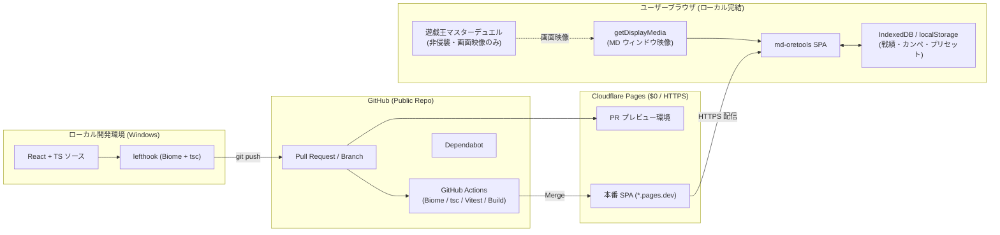
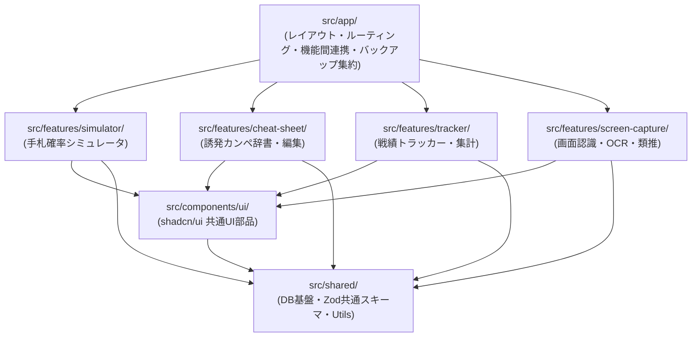

# md-oretools - Antigravity プロジェクトルール

このリポジトリは、遊戯王マスターデュエルを便利にする個人用ポータルWebアプリ（FF14俺Tools風）である **md-oretools** の開発プロジェクトです。

## プロジェクト方針・大原則

1. **安全・非侵襲なアプローチを厳守する**
   - ゲームクライアントのプロセス・メモリ読み取りや、通信パケットの解析・改ざんは**一切行わない**。
   - 自動化・認識機能はすべて、ブラウザ標準の Screen Capture API（`getDisplayMedia`）による画面映像の読み取り（画像解析・OCR）のみで完結させる。
2. **完全フロントエンド完結（$0 運用・個人利用ファースト）**
   - サーバーレス・ブラウザ完結で動作するSPAとして設計し、Public リポジトリ ＋ Cloudflare Pages で無料配信する。
   - 戦績データや自分用カンペメモなどの永続化にはブラウザストレージ（`IndexedDB` / `localStorage`）を使用し、Zod で検証可能な JSON エクスポート／インポート機能を備える。
3. **権利・セキュリティ配慮**
   - 公式カード画像やイラストは一切ホスト・スクレイピングせず、テキスト・自作アイコン・CSS/SVG のみでUIを構成する。
   - 個人データ（戦績・メモ）はリポジトリに含めず、すべてクライアント側ストレージに保存する。
4. **ボトムアップ型で段階的に開発する**
   - 詳細は [docs/spec.md](docs/spec.md) および [docs/architecture.md](docs/architecture.md) を参照し、フェーズ順に実装・検証を進める。

---

## 確定技術スタック

| カテゴリ                | 採用技術                                            | 備考                                                                 |
| :---------------------- | :-------------------------------------------------- | :------------------------------------------------------------------- |
| フレームワーク / ビルド | Vite + React + TypeScript                           | TS は `strict` + `noUncheckedIndexedAccess` 有効                     |
| UI / スタイリング       | Tailwind CSS + shadcn/ui                            | ダークモード基調、ランタイム負荷ゼロ                                 |
| パッケージ管理          | npm                                                 | Node.js 24 LTS（`.nvmrc` で固定）、CI は `npm ci`                    |
| Lint / Format           | Biome                                               | 単一設定（`biome.json`）で高速実行                                   |
| 静的解析 / 品質ゲート   | SonarQube Cloud + SonarQube for IDE（旧 SonarLint） | Public リポ無料。CI 品質ゲート＋カバレッジ可視化＋IDE Connected Mode |
| テスト                  | Vitest                                              | ドメインロジック（確率計算・類推・集計）中心                         |
| バリデーション          | Zod                                                 | JSON インポート/エクスポート検証・型定義の正                         |
| 永続化                  | IndexedDB（Dexie.js） / localStorage                | `schemaVersion` によるマイグレーション対応                           |
| 画面認識 / 検索         | `getDisplayMedia` + Canvas + Tesseract.js + Fuse.js | Phase 3 で導入                                                       |
| Git Hooks / CI          | lefthook + GitHub Actions + Dependabot              | commit 前・PR 時の自動品質ゲート                                     |
| ホスティング            | Cloudflare Pages（Public リポ連携）                 | HTTPS 標準・PR プレビュー・帯域無制限（$0）                          |
| PWA                     | `vite-plugin-pwa`                                   | Phase 1 後半〜Phase 2 で後付け導入                                   |

---

## アーキテクチャ概要

詳細なデータフロー・スキーマ設計は [docs/architecture.md](docs/architecture.md) を参照。

### 1. システム構成・配信アーキテクチャ



### 2. ディレクトリ構成と依存ルール（Feature-based）

機能単位で疎結合に保ち、**`features/` 同士の直接参照・`shared/` から `features/` への逆参照・`domain/` の React 依存を `biome.json` の `noRestrictedImports` で自動禁止**する（機能間連携およびバックアップスキーマ集約は `src/app/` 経由で行う）。



```text
src/
├── app/                   # エントリ・ルーター・共通シェル（サイドバー/ヘッダー）
├── components/ui/         # shadcn/ui コンポーネント（CLI生成・共通UI部品）
├── features/
│   ├── simulator/         # 手札確率シミュレータ（domain / components / hooks）
│   ├── cheat-sheet/       # 誘発カンペ（domain / data / components / hooks）
│   ├── tracker/           # 戦績トラッカー（domain / components / hooks）
│   └── screen-capture/    # 画面認識・OCR・デッキ類推（domain / components / hooks）
└── shared/
    ├── db/                # IndexedDB (Dexie.js) / ストレージ抽象化
    ├── lib/               # 共通ユーティリティ（cn 等）
    ├── schemas/           # 共通 Zod スキーマ・JSON バックアップ形式
    └── types/             # 共通型定義
```

- **ロジック分離原則**: 計算・類推・集計・バリデーションなどのドメインロジックは React に依存しない純粋関数として `domain/` に切り出し、Vitest で単体テストを書く。

---

## コーディング・ドキュメント規約

- UI文言、コメント、ドキュメント、コミットメッセージは**日本語**で記述する。
- 文字コードは **BOMなし UTF-8**、改行コードは **LF (`\n`)** を徹底する（`.gitattributes` / `.editorconfig` で強制）。
- コミット前に `npm run check`（Biome check）・`npm run typecheck`（`tsc -b --noEmit`）・`npm test` が通る状態を保つ（`lefthook` が `pre-commit` / `pre-push` で自動検証する）。
- 仕様変更や新しいフェーズに入る際は、[docs/spec.md](docs/spec.md) および [docs/architecture.md](docs/architecture.md) を最新の状態に保つ。
