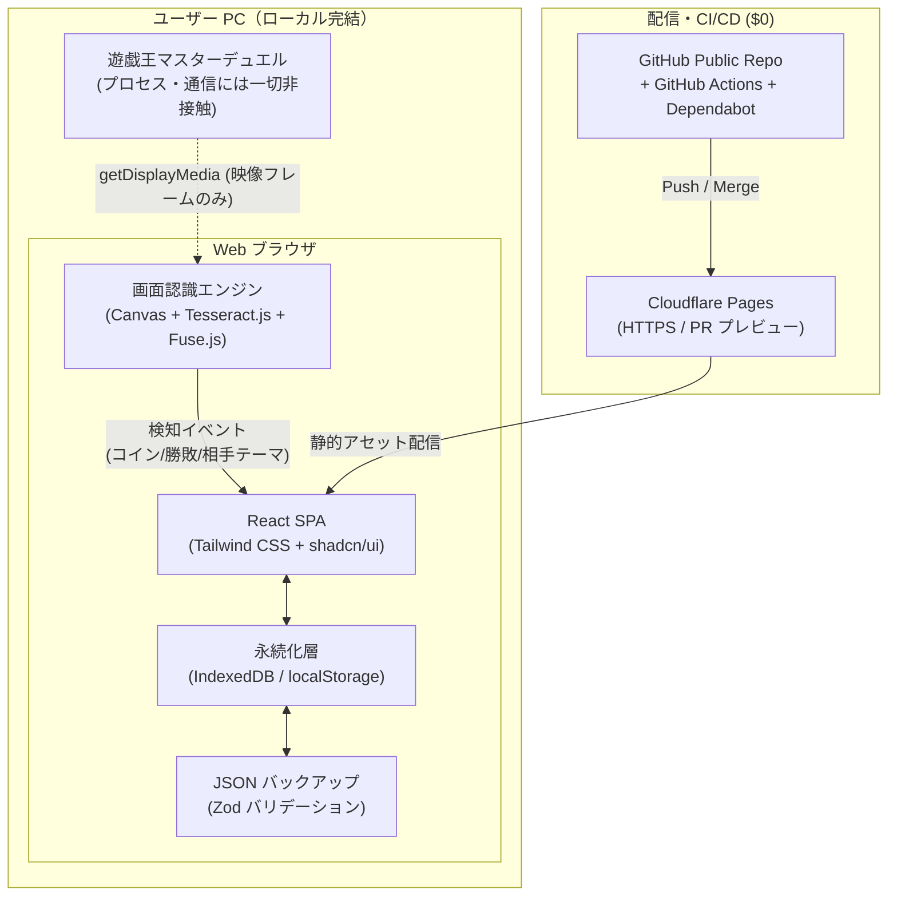
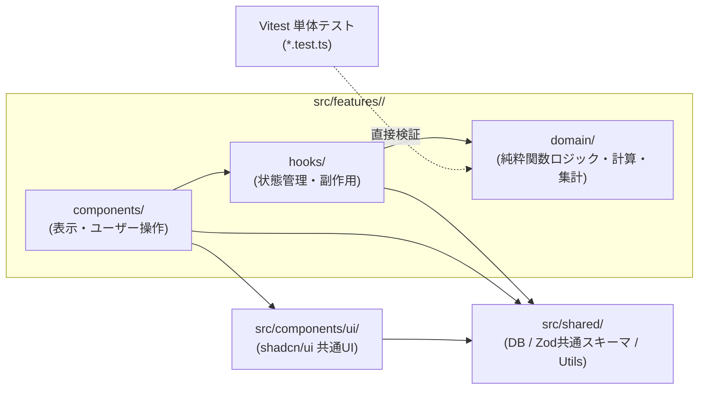
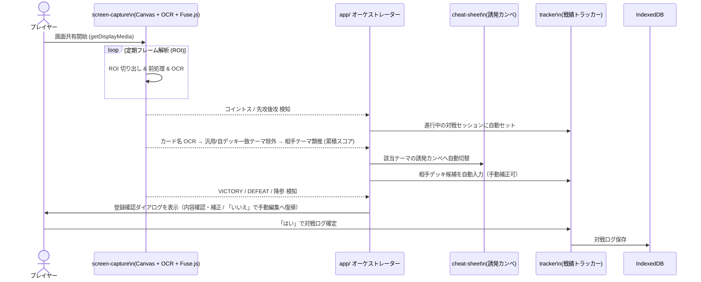
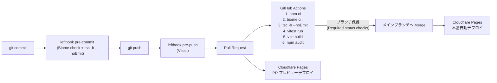

# md-oretools アーキテクチャ設計書

本ドキュメントは、`md-oretools` のシステム構成・フロントエンド設計・データ永続化方針・Phase 3 技術リスク対策・CI/CD 品質ゲートを定義します。

---

## 1. システム全体像（サーバーレス・完全無料構成）

バックエンドサーバーを持たず、GitHub + Cloudflare Pages の無料枠のみで静的 SPA を HTTPS 配信します。
Screen Capture API（`getDisplayMedia`）は `localhost` 以外で **HTTPS が必須**となるため、Cloudflare Pages の自動 SSL を前提とします。

---

## 2. フロントエンド層別設計（Feature-based Architecture）

各機能（`features/*`）の内部は、テスト容易性と保守性を高めるため以下の責務に分離します。

### 依存ルール（`biome.json` で自動強制）

1. **`domain/` は React / DOM / ブラウザ API に依存しない純粋な TypeScript** とし、Vitest で高速にテスト可能にする（`biome.json` で `react` / `react-dom` / UI 部品の import を禁止）。
2. **`features/` 同士の直接インポート・`shared/` から `features/` への逆参照を禁止**する（`biome.json` の `noRestrictedImports` でエラー化）。機能間連携および各機能のデータスキーマを集約したバックアップ処理は `src/app/` 層で行う。
3. UI 部品は `src/components/ui/` に配置する（初期の `button.tsx` / `card.tsx` は最小構成の手書き実装。ダイアログ等の複雑な部品を追加する際は `npx shadcn add` を利用する）。

---

## 3. リアルタイム連携シーケンス（Phase 3 実装済み）

画面認識エンジンから誘発カンペ・戦績トラッカーへの連携フローです。

---

## 4. データ永続化・スキーマ保護戦略

ブラウザ完結アプリでは、アップデート時のデータ破損およびブラウザ側のストレージ削除対策が最重要です。

- **永続化レイヤーの役割分担**:
  - Phase 1 からアプリデータ（プリセット・誘発カンペ・対戦ログ・デッキ・ROI 設定）は **IndexedDB（Dexie.js）** に統一し、`localStorage` はサイドバー状態など軽量な UI 設定のみに限定する。
- **スキーマバージョニングと Zod 4 検証**:
  - IndexedDB（Dexie.js）の `version(n)` を用いて段階的にマイグレーションを定義する。
  - JSON エクスポート共通エンベロープ（`src/shared/schemas/backup.ts`）に `schemaVersion`・`exportedAt` を持たせ、現行バージョンより未来の未対応スキーマは明示的に拒否する。各 feature のデータスキーマを集約した完全スキーマは `src/app/` 層で `createBackupSchema()` により合成する。
  - JSON インポート時は **「全置換（上書き）」** と **「マージ（ID ベースで追加・更新）」** を選択可能にする。
- **ストレージ消失・競合対策**:
  - `navigator.storage.persist()` を要求し、ブラウザの自動ストレージ追い出しを緩和する。
  - オリジン単位でデータが分離されるため（`*.pages.dev`・PR プレビュー・独自ドメイン間で非共有）、定期的な JSON バックアップ導線を UI に設ける。
  - 複数タブ同時起動時の Dexie スキーマ更新に備え、`versionchange` イベントのハンドリングを実装する。
- **PWA 対応**:
  - `vite-plugin-pwa` をビルド外側に追加するのみで完結させ、アプリ内部設計には影響させない。
  - Tesseract.js の学習データ（大容量）はプリキャッシュ対象外とし、ランタイム取得とする。

---

## 5. 技術リスクと現行対策・今後の検討事項

### テスト基盤

- Vitest 既定環境は `node`（高速な純粋関数テスト向け）。
- IndexedDB / DOM / Canvas をテストするファイルが必要になった場合は `// @vitest-environment jsdom`（または `happy-dom`）と `fake-indexeddb` をファイル単位で導入する方針とする。

### 画面認識・OCR の技術リスクと対策

- **バックグラウンド throttling 対策**: ゲーム中にアプリタブが非表示になると `setTimeout` が制限される。現行実装は `setTimeout` ベースの定期解析であり、サブモニター表示または **PWA 独立ウィンドウでの前面表示** を前提とする（タブ裏実行の安定化が必要な場合は `requestVideoFrameCallback` / Web Worker タイマー / Document PiP の導入を検討）。
- **キャプチャ環境と解像度非依存**: 排他フルスクリーン環境では黒画面になるケースがあるため、マスターデュエル側はボーダーレスウィンドウ推奨とする。ROI 座標はピクセル固定ではなく **16:9 実測値ベースの比率（相対座標 `0.0〜1.0`）** で保持し、UI 上で微調整可能にする。対応ブラウザは Chromium 系（Chrome / Edge）を主対象とする。
- **Tesseract.js のアセット配信と精度対策**: 日本語 UI 前提で `jpn` 言語データ（`OEM.LSTM_ONLY` / `PSM.SINGLE_LINE`）を使用し、Canvas 前処理（2倍拡大・白余白パディング・明文字の反転抽出）＋信頼度閾値＋累積スコア＋確認ダイアログでの手動補正 UI で精度を補完している。現行は `tesseract.js` 標準の CDN 取得を利用しており、完全オフライン動作や厳格な CSP が必要になった場合は Cloudflare Pages の 1 ファイル 25MiB 上限内に収まる軽量版学習データ（`fast` モデル等）の自前ホスト（`workerPath` / `corePath` / `langPath`）を検討する。
- **カード名辞書データ**: 公式画像・アセットは一切使用せず、カード名・テーマ対応辞書はユーザー編集可能なローカルデータ（初期テンプレートのみ同梱）として管理する。

---

## 6. CI/CD と品質ゲート・Cloudflare Pages 運用

- **重要（Cloudflare Pages と CI の関係）**: Cloudflare Pages の Git 連携は GitHub Actions とは独立して push 時に自動デプロイされる。CI 未通過コードの本番反映を防ぐため、**GitHub のブランチ保護ルール（Required status checks: `quality`）を有効にし、PR 経由でのみマージする運用**を前提とする。
- **Cloudflare Pages ビルド設定**:
  - Build command: `npm run build`
  - Build output directory: `dist`
  - Node.js バージョン: `.nvmrc`（`24`）または環境変数 `NODE_VERSION=24`
  - SPA ルーティング: `404.html` を置かない Cloudflare Pages 標準の自動 SPA フォールバックを利用する（`public/_redirects` の `/* /index.html 200` は不要・警告回避のため置かない）。
- **依存管理（Dependabot）**: 週次で npm 依存関係および GitHub Actions バージョンの更新 PR を自動作成。
